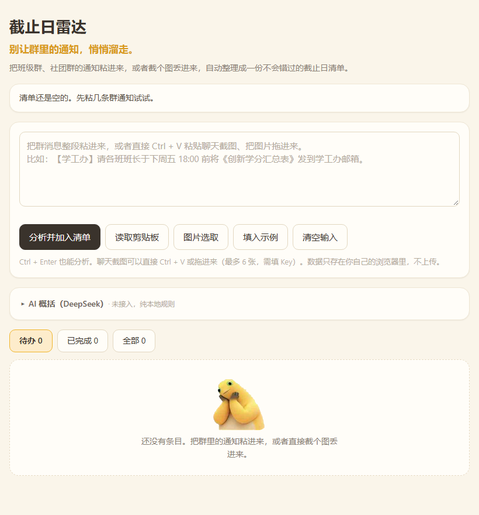
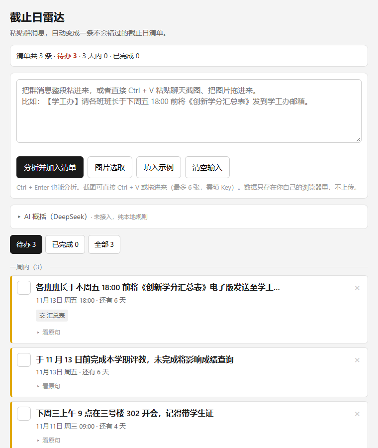

# 截止日雷达 · Deadline Radar

> 把一堆群通知粘进来，30 秒变成一条不会错过的截止日清单。

**中源黑客松 · 河南大学站（HENU HACK 2026）· 赛道 02 AI × EFFICIENCY 效率革命**

---

## 这是什么

每个学期，学生要在十几个群里盯着通知。截止日不是没发，是埋在几百条消息中间，漏掉一次就是一次挂科风险。

这个工具把整段群消息粘进去，自动抽出「做什么、什么时候交、要交什么材料」，排成一条按日期排列的清单，并且能一键导出成 `.ics` 日历文件——导进手机之后，两个月后手机会替你记着。

## 在线试用

- 网页版：https://deadline-radar-05483.app.workbuddy.host/?sharecode=ER325EGZ2M
- 演示视频：【待填：录屏链接，没有就把这一行删掉】

## 怎么运行（评委请看这里）

**不需要安装任何东西，不需要命令行。**

1. 下载本仓库（点右上角绿色 `Code` 按钮 → `Download ZIP`）
2. 解压
3. 双击 `index.html`，用浏览器打开即可

> 不填 API Key 也能完整使用（纯本地规则解析，断网可用）；想让 AI 把杂乱的群聊概括成一句话待办，需要在页面里填一个自己的 DeepSeek Key（只存在本地浏览器，不会上传）。
>
> 如果你只想快速看效果，直接点上面的在线试用链接，不用下载。

## 界面

【待填：明早截 2 张图存进 screenshots/ 目录，文件名照下方写，改完把这一行删掉】
【截图建议：① 输入一段群通知的界面 ② 解析出的时间轴结果】

```


```

## 功能

只列真正做完了的，没做完的不要写。

1. **群通知解析**：粘贴整段群消息，或者**直接把聊天截图 Ctrl + V 粘进来**（也能拖进网页、手机上从相册选），自动拆出多条待办，每条带「做什么 / 截止时间 / 要交的材料 / 原文出处」，可以点开原句核对，避免 AI 抽错。
2. **紧急分级与分组**：清单自动分成「已过期 / 3 天内 / 一周内 / 更远 / 未注明日期」五档，3 天内到期的标红，一眼看出哪件事马上要交。
3. **导出到手机日历**：一键生成 `.ics` 文件，导入手机后是带提前 12 小时提醒的日程事件；另外支持一键复制成纯文本清单。

## 技术说明

- 形式：纯前端网页，所有文件放在同一目录，双击 `index.html` 就能跑；**零依赖、零构建、不需要服务器**
- 抽取方式：两层。**规则引擎**在本地解析日期与材料（断网可用）；**DeepSeek 大模型**负责把杂乱的群聊概括成一句话待办（模型 `deepseek-flash`，关闭思考模式以降低延迟与成本）。没填 Key、超时或网络不可用时自动降级为纯规则模式，功能不中断
- 截图识别：`deepseek-flash` 自带图像理解，截图先在前端用 canvas 压到长边 1800、JPEG 0.9 再上传，单张最多算 1024 token（约一分钱不到）；一次最多 6 张，粘贴时自动合并去重
- 数据存储：浏览器本地存储（localStorage），不上传任何用户数据，关闭页面后重新打开内容还在

## 赛前成果与比赛期间新增内容

> 比赛规则要求明确区分，如实填写。

- **赛前已有的部分**：一个界面骨架，以及日期/材料规则解析的技术验证（v0.1）
- **比赛期间新增**：
  - 11.07 上午：完整抽取逻辑、事项卡片、来源原句对照
  - 11.07 下午：紧急程度分组与异常情况处理、截图输入（粘贴 / 拖拽 / 相册选图，前端压缩后交给 DeepSeek 视觉）、AI 层从多服务商收敛为 DeepSeek 单一链路
  - 11.07 晚上：`.ics` 导出、复制清单、移动端适配
  - 11.08 上午：空状态与错误提示、边界用例修补、演示材料

## 团队分工

| 成员 | GitHub | 负责 |
|---|---|---|
| 【待填：你的姓名】 | [@28-ddM](https://github.com/28-ddM) | 技术实现主线、范围与进度把控、答辩技术问题 |
| lfl | 【待填：GitHub 用户名】 | 界面与交互实现、视觉与动效 |
| zyx | 【待填：GitHub 用户名】 | 需求调研与文案、演示与答辩表达、测试语料整理 |

## 三人怎么协作

- **改代码前先 `git pull`；改完 `git add -A && git commit -m "[fix] 改了什么" && git push`**
- **每个文件只有一个负责人**，改别人的文件前先在群里说一句
- 详细规则（文件地盘、commit 格式、冲突处理、时间节点）见 [`docs/协作规范.md`](docs/协作规范.md)
- 产品需求见 [`docs/PRD.md`](docs/PRD.md)；范围、分工与时间表见 [`docs/开发目标书.md`](docs/开发目标书.md)

## 仓库结构

```
├── index.html          # 主页面，双击即可运行
├── docs/               # PRD、开发目标书、答辩话术、协作规范
├── screenshots/        # README 引用的界面截图
└── README.md
```

## 使用了哪些 AI 工具

【待填：把你俩实际用过的写进来，例如 WorkBuddy / Claude / 豆包 / DeepSeek 用于代码生成与调试】

说明：代码由 AI 辅助生成，架构设计、提示词设计、规则逻辑、调试与集成由团队成员完成。

---

*本项目为 HENU HACK 2026 参赛作品。*
