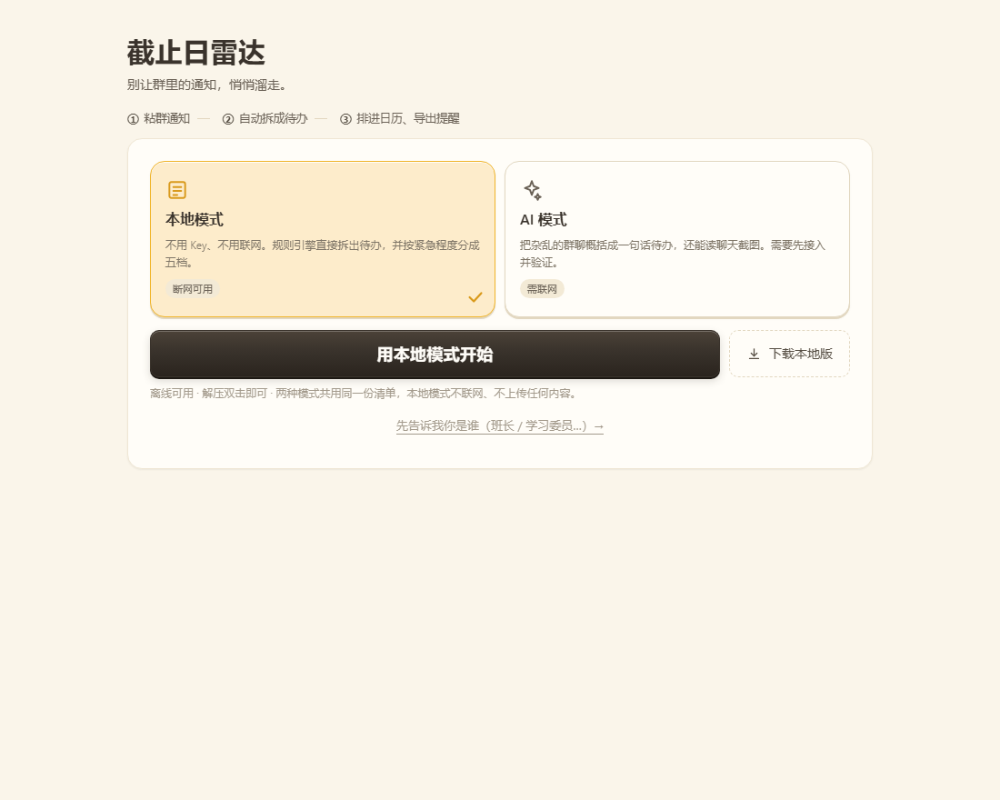
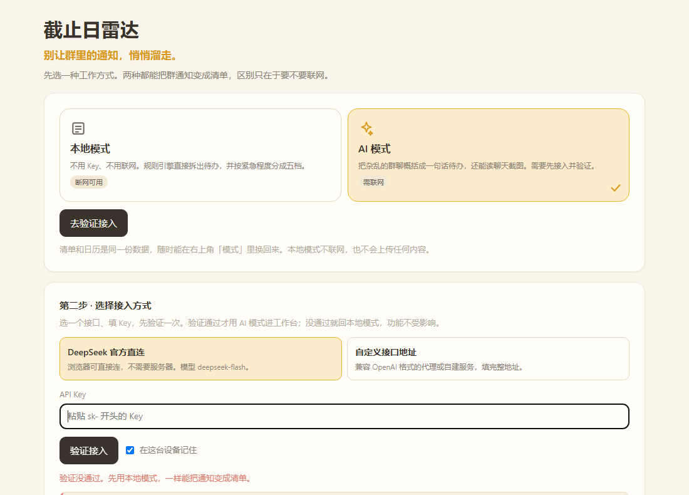

# 截止日雷达 · Deadline Radar

> 把一堆群通知粘进来，30 秒变成一条不会错过的截止日清单。

**中源黑客松 · 河南大学站（HENU HACK 2026）· 赛道 02 AI × EFFICIENCY 效率革命**

---

## 这是什么

每个学期，学生要在十几个群里盯着通知。截止日不是没发，是埋在几百条消息中间，漏掉一次就是一次挂科风险。

这个工具把整段群消息粘进去，自动抽出「做什么、什么时候交、要交什么材料」，排成一条按日期排列的清单，并且能一键导出成 `.ics` 日历文件——导进手机之后，两个月后手机会替你记着。

## 在线试用

- 网页版：https://deadline-radar-05483.app.workbuddy.host/?sharecode=ER325EGZ2M
- 下载子站（离线包 + 校验信息）：https://deadline-radar-05483.app.workbuddy.host/download/?sharecode=ER325EGZ2M
- 手机扫码即开（无需安装）：


## 怎么运行（评委请看这里）

**不需要安装任何东西，不需要命令行。**

1. 下载本仓库（点右上角绿色 `Code` 按钮 → `Download ZIP`）；或从[下载子站](https://deadline-radar-05483.app.workbuddy.host/download/?sharecode=ER325EGZ2M)直接获取离线包 `deadline-radar-1108.zip`（页面附 SHA-256 校验值）
2. 解压
3. 双击 `index.html`，用浏览器打开即可

> 整个文件夹一起拷走最稳妥。只留 `index.html` 也能跑，功能完全正常，只是片头会退化成静帧版（原因见文末「仓库结构」）。想跳过片头，打开 `index.html?nointro`。

> 不填 API Key 也能完整使用（纯本地规则解析，断网可用）；想让 AI 把杂乱的群聊概括成一句话待办，需要在页面里填一个自己的 DeepSeek Key（只存在本地浏览器，不会上传）。
>
> 如果你只想快速看效果，直接点上面的在线试用链接，不用下载。

## 界面

**① 选择工作方式**：本地模式不联网、不用 Key；AI 模式要先选接入方式、再验证一次，验证不过就回本地。两种模式的清单和日历是同一份数据。



**② 工作台**：粘文字、读剪贴板、选截图四条输入路径；清单按紧急程度分五档，左侧色条区分，清单上方会说明这五档分类。


**③ AI 接入与验证**：DeepSeek 官方直连，或填一个兼容 OpenAI 格式的自定义地址。点「验证接入」会真实调一次接口；不通过就地给出「改用本地模式」，不会卡在门口。



**④ 日程周历**：按周查看每一条截止日，有截止日的日期格带彩色圆点，点某一天只看那天；支持关键词筛选。


> 前两张是**不联网的本地模式**——规则引擎只会「摘原句」，不会概括。切到 AI 模式并验证通过后，标题会被压成一句话（比如「交创新学分汇总表」），日期也按消息的发送时间重新换算；第三张就是 AI 接不通时的退路。

## 功能

1. **四条输入路径**：粘贴整段群消息、**一键「读取剪贴板」**、把聊天截图直接 `Ctrl + V` 粘进来或拖进网页、手机上从相册「图片选取」。自动拆出多条待办，每条带「做什么 / 截止时间 / 要交的材料 / 原文出处」，可以点开原句核对，避免 AI 抽错。
2. **紧急分级与分组**：清单自动分成「已过期 / 3 天内 / 一周内 / 更远 / 未注明日期」五档，左侧色条区分紧急程度，一眼看出哪件事马上要交。
3. **导出到手机日历**：一键生成 `.ics` 文件，导入手机后是带提前 12 小时提醒的日程事件；另外支持一键复制成纯文本清单。
4. **累积清单，不是一次性转换**：手动粘贴的每批新通知会与已有清单按「标题 + 日期 + 时间」去重后合并，一整个学期的截止日留存在同一处；可勾选完成、按待办 / 已完成 / 全部切换查看。点「填入示例」换案例时则是整份替换（旧清单留了快照，撤销能找回）。
5. **三屏一体**：模式选择 → 工作台 → 日程周历，在一个文件里用显示切换完成，没有第二个 HTML；本地模式与 AI 模式共用同一套解析引擎，清单与日历读的是同一份数据。
6. **11 套场景示例，随机且不重样**：班群日常、社团活动、教务考试、学科竞赛、宿舍后勤、实习就业、志愿公益、资助奖助、学习小组、工作部门、家庭生活，每套都能解析出 12 条待办。点「填入示例」随机取一套并直接出结果，一轮发完才重新洗牌，连续点也不会连着看到同一套；右下角会显示「示例 3/11 · 教务考试」，一眼看出在用第几套。
7. **关键词库（我的身份 / 我关注的事）**：告诉它「你是谁、关心什么」（如班长、竞赛、奖助），解析出的条目命中身份词会标记「这条点名到你」并在组内排最前；命中「不关心」的条目（如二手、拼单）自动折叠，工作台和周历同一套行为。
8. **识别「任务要求对象」**：从通知里抽出「各班班长 / 全体同学 / 参赛队伍」这类要求对象，与关键词库比对，判断这件事点没点到你——这是「相关度排序」的依据，不靠猜。
9. **手势与音效**：卡片左滑过半删除（带红色底衬跟随手指），点 × 删除会「消散」；删除后弹出可撤销提示，连删多条时撤销精确回到各自的快照；勾选完成有「笔划掉」动效。全套音效由 Web Audio 实时合成（无音频文件、断网可响），首屏即可一键关闭。
10. **导出前的导入教程**：首次下载 `.ics` 前弹一次图文教程（iOS / 安卓分别怎么导入），可勾选「不再提示」，也能在关注面板里随时重新打开。

## 凭什么是我们

「AI 总结群聊」这件事，腾讯元宝、飞书智能助手都能做。我们的差别在三处：

**一、断网也能出结果。**
规则引擎跑在浏览器本地，不联网、不填 Key，粘贴文字照样能抽出「做什么 + 什么时候交 + 要交什么」。AI 是加在它之上的增强，不是命脉——网络断了、Key 欠费了、模型超时了，功能都不会变成白屏，最多从「概括成一句话」退回到「摘原句」。

**二、手机上，截图比复制快十倍。**
微信里想复制一整段群通知，得一条条长按复制；截图只要按两个键。所以这个工具的第一入口不是「粘贴文字」，而是「粘一张截图」。这是我们在手机上实测出来的结论，也是这个赛道的题眼——真正的效率提升常常不在算法，而在少做几步。

**三、导出的不是清单，是日历事件。**
生成标准 `.ics` 文件，导进手机后是带提前 12 小时提醒的日程。两个月后，是手机在提醒你，不是这张网页。网页会关掉，手机不会。

这三条其实是一件事：**把截止日从「要记住的东西」变成「不用记的东西」。**

## 技术说明

- 形式：纯前端网页，双击 `index.html` 就能跑；**零依赖、零构建、不需要服务器**。界面与逻辑同在一个文件，配色集中在 `<style>` 开头的 `:root` 变量里
- 抽取方式：两层。**规则引擎**在本地解析日期与材料（断网可用）；**DeepSeek 大模型**负责把杂乱的群聊概括成一句话待办（模型 `deepseek-flash`，关闭思考模式以降低延迟与成本）。没填 Key、超时或网络不可用时自动降级为纯规则模式，功能不中断
- 截图识别：`deepseek-flash` 自带图像理解，截图先在前端用 canvas 压到长边 1800、JPEG 0.9 再上传，单张最多算 1024 token（约一分钱不到）；一次最多 6 张，粘贴时自动合并去重
- 剪贴板读取：`navigator.clipboard.readText()`，需 https 或 localhost 且由用户点击触发；本地 `file://` 或手机浏览器不给权限时，如实提示改用 `Ctrl + V`，不会假装成功
- 视觉实现：**没有引入 Tailwind CSS**。设计要求的效果（16px 统一圆角、极淡单一阴影、200ms 过渡、暖黄配色）用原生 CSS 变量就能实现；引入 CDN 会让「断网也能用」这个核心卖点变成断网样式全丢，与产品定位自相矛盾。界面规范见 [`docs/UI对接清单.md`](docs/UI对接清单.md)
- 三屏结构：模式选择、工作台、日程周历是同一个 `index.html` 里的三个 `<section>`，用 `hidden` 属性切换；所有元素都在同一份文档里，脚本 `getElementById` 全部有效。周历读的是同一份清单，不另存数据
- 示例素材库：11 套场景 × 每套 12 条通知写在同一个文件里，用「洗牌袋」随机取号——一轮内不重复，一轮发完自动重洗并避开刚看过的那套；已发到第几套记在 localStorage，刷新页面接着往下发（浏览器禁用存储时退回内存，同样不重复）
- 空状态插图：两张奶龙素材已抠成透明底并内联为 data URL，单文件分发、断网、`file://` 打开都能正常显示，不依赖外部图片请求
- 音效：全部由 Web Audio 实时合成（点按 / 勾选 / 删除 / 警告四组音色），不请求任何音频文件，断网可响；首屏与工作台均可一键关闭
- 数据存储：浏览器本地存储（localStorage），不上传任何用户数据，关闭页面后重新打开内容还在

## 赛前成果与比赛期间新增内容

- **赛前已有的部分（11.06 晚）**：界面骨架，以及日期 / 材料规则解析的技术验证（v0.1）
- **比赛期间新增（11.07）**：
  - 上午：完整抽取逻辑、事项卡片、来源原句对照；修复浏览器禁用本地存储时页面点不动的问题
  - 下午：紧急程度五档分组、截图输入（粘贴 / 拖拽 / 相册选图，前端压缩后交给 DeepSeek 视觉）、AI 层收敛为 DeepSeek 单一链路、`.ics` 导出与复制清单、原生弹窗换成页面内提示、配色收敛为可替换的 CSS 变量
  - 傍晚：按视觉规范落地暖黄主题（16px 统一圆角 / 单一淡阴影 / 200ms 过渡 / 电脑端适配）、一键读取剪贴板、空状态引导插图、超出 6 张图片时明确提示、模式选择 / 工作台 / 日程周历三屏（单文件内切换）与周历视图、入场片头（视频 + 抠图 + 笑声，素材独立在 `media/intro/`，缺失时自动降级）
  - 晚间：示例素材库扩成 8 套场景 × 每套 12 条待办（11.08 已扩至 11 套），随机换案例且一轮内不重复；标题自动剥掉重复的日期/时间（句中不动，避免剥成病句）；「3 号楼」这类地址不再被误认成日期
- **比赛期间新增（11.08 凌晨）**：交互增强九连（音效内核 / 删除消散动效 / 左滑删除 / 勾选笔划掉 / ics 导入教程 / 关键词库 / 长文本卡片自适应 / 任务要求对象识别 / 首屏排版重整与下载子站入口），并修复 13 项缺陷（下载子站误发旧版包、滑动删除双音效、多条删除撤销错位、相关度只写不读、日历视图折叠失效、「不再提示」不可逆、首屏缺关注入口与音效开关、AI Key 提示、焦点归还与无障碍属性、清单校验等）
- **比赛期间新增（11.08 上午）**：界面视觉重构（副标题层级、统计行色块快捷筛选、清空入口下沉、提示折叠、输入框自适应、tab 图标、卡片四层层级、倒计时胶囊、重复标记、紧急程度下拉、删除按钮显隐与 44px 热区），并优化 iOS 日历导入引导（浏览器下载列表 → 选「日历」打开）
- **验收**：本地 43/43 + 回车 8/8 + v2.1 交互 18/18 + 动效 18/18（减动效模式 14/14）+ 界面重构专项 53/53（修复两处测试时序后三连跑稳定全绿）+ 片头专项 11/11 + 语法与解析基线全过；线上专项 14/14 为 11.08 凌晨 v2.2 部署的实测数据（含离线包真实下载、片头视频可播、全站零 4xx/5xx），v1.0 重新部署后需重跑更新；交付包 `MANIFEST.md5` 42 项全部一致
- **11.08 中午**：README 定稿与全渠道一致性核对（本地 / 离线包 / 下载子站 / MANIFEST）；公网重新部署与 GitHub 推送进行中；演示材料与答辩手册已就绪

## 团队分工

| 成员 | GitHub | 负责 |
|---|---|---|
| 28-ddM | [@28-ddM](https://github.com/28-ddM) | 技术实现主线、范围与进度把控、答辩技术问题 |
| lfl | [@LFLlfl123](https://github.com/LFLlfl123) | 界面与交互实现、视觉与动效 |
| zyx | [@yunye1203](https://github.com/yunye1203) | 需求调研与文案、演示与答辩表达、测试语料整理 |

## 三人怎么协作

- **改代码前先 `git pull`；改完 `git add -A && git commit -m "[fix] 改了什么" && git push`**
- **每个文件只有一个负责人**，改别人的文件前先在群里说一句
- 详细规则（文件地盘、commit 格式、冲突处理、时间节点）见 [`docs/协作规范.md`](docs/协作规范.md)
- 产品需求见 [`docs/PRD.md`](docs/PRD.md)；范围、分工与时间表见 [`docs/开发目标书.md`](docs/开发目标书.md)

## 仓库结构

```
├── .gitignore                 # 忽略 assets/ 与临时文件
├── index.html                 # 主页面，双击即可运行（界面与逻辑都在这一个文件里）
├── MANIFEST.md5               # 交付包 42 项文件校验清单（防篡改/防漏文件）
├── docs/
│   ├── PRD.md                 # 产品需求
│   ├── 开发目标书.md           # 范围、分工与时间表
│   ├── 答辩话术.md             # 现场表达与预设问答
│   ├── 协作规范.md             # 三人协作约定
│   ├── UI对接清单.md           # 界面改造的边界与验收清单
│   ├── UI改造提示词.md         # 交给 UI 同学的一次性改造提示词（含 id 清单与红线）
│   └── README模板.md           # 赛道官方 README 模板留档
├── download/                  # 下载子站：离线包 deadline-radar-1108.zip + 校验信息 + 截图
├── media/intro/               # 片头素材：奶蛙视频、抠图、笑声（二进制，未内联）
├── assets/                    # 设计源素材（奶龙原图、森林背景、生肖帧）：本地留档，不参与运行，已在 .gitignore 忽略
├── screenshots/               # README 引用的界面截图与线上版二维码
└── README.md
```

> 空状态插图、森林背景、生肖动效帧都已抠图/压缩后以 data URL 内联在 `index.html` 里，**运行时不请求任何图片文件**；`assets/` 只是留档的设计源图（已被 `.gitignore` 忽略，克隆仓库或解压交付包都不含它），删掉不影响使用。
>
> 片头用到的视频与笑声是二进制素材，内联会让 `index.html` 膨胀近一倍，所以单独放在 `media/intro/`（已随仓库提交，不在 `.gitignore` 里）。只拿走 `index.html` 一个文件时，片头会退化成静帧版：雾散、金字推近、无笑声、奶蛙不动，页面本身不受影响（代码里有 `i-novid` 兜底，不会出现破图或白屏）。

## 使用了哪些 AI 工具

WorkBuddy 用于代码生成、调试与文档撰写；DeepSeek `deepseek-flash` 用于运行时的待办抽取与聊天截图识别。

说明：代码由 AI 辅助生成，架构设计、提示词设计、规则逻辑、调试与集成由团队成员完成。

## 素材说明

页面空状态使用的「奶龙」形象为奥飞娱乐旗下 IP，仅用于本次校内比赛的界面设计学习与展示，不作商业用途，版权归原权利人所有。素材取自公开网络，已抠成透明底并内联在页面中；如需正式发布，将替换为团队自绘形象。

---

*本项目为 HENU HACK 2026 参赛作品。*
