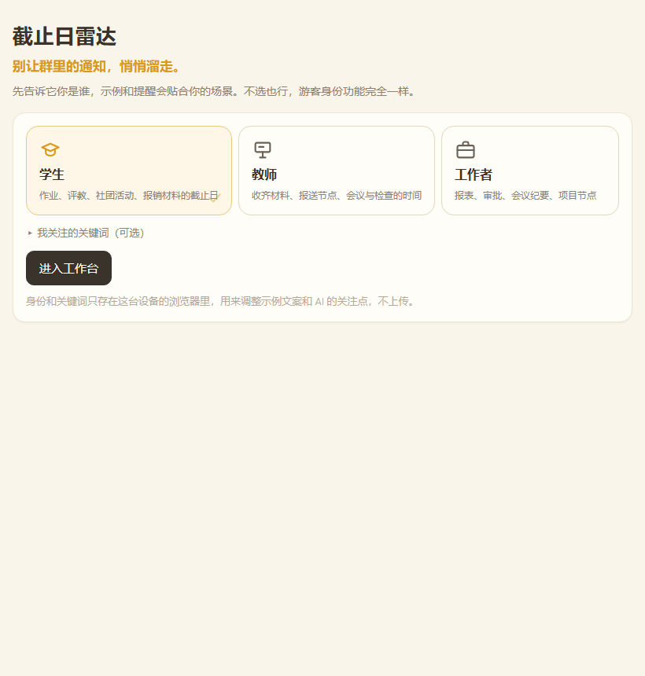
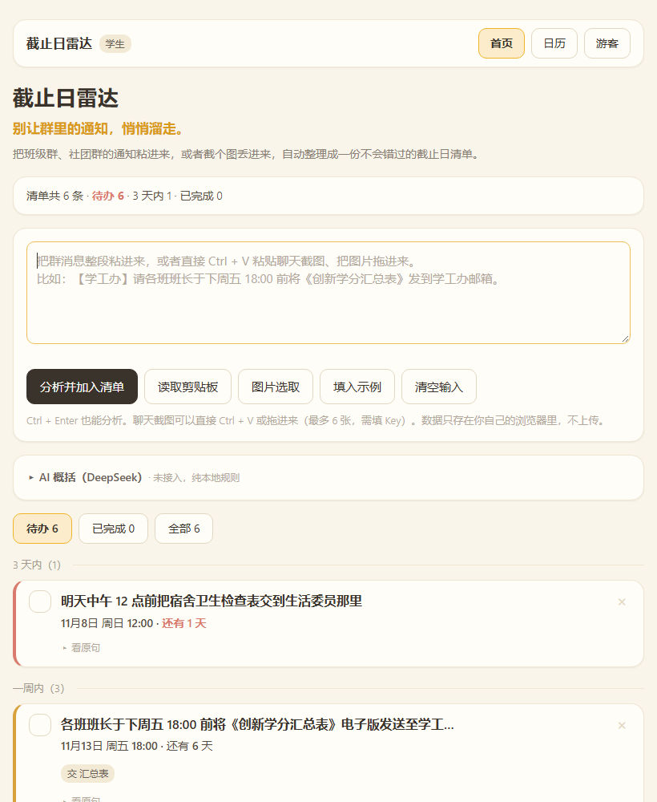
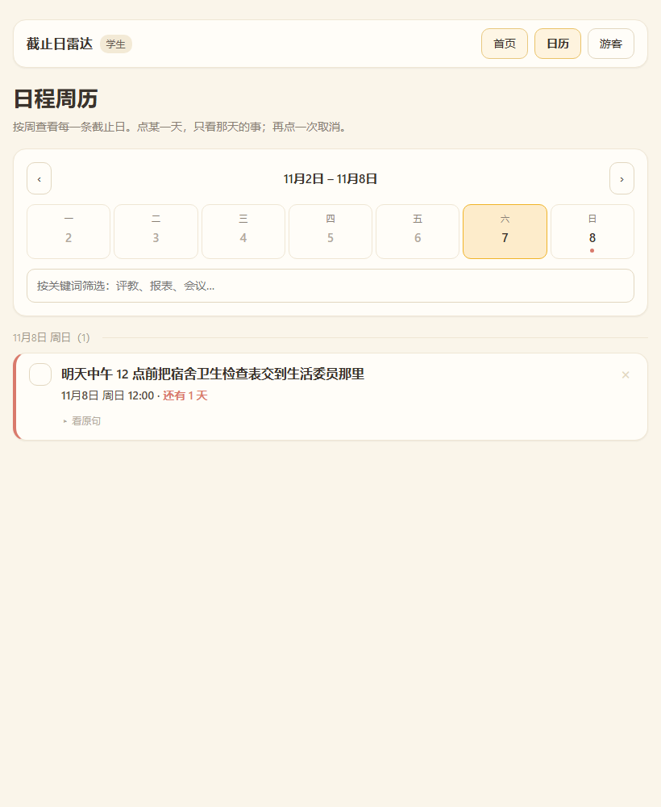

# 截止日雷达 · Deadline Radar

> 把一堆群通知粘进来，30 秒变成一条不会错过的截止日清单。

**中源黑客松 · 河南大学站（HENU HACK 2026）· 赛道 02 AI × EFFICIENCY 效率革命**

---

## 这是什么

每个学期，学生要在十几个群里盯着通知。截止日不是没发，是埋在几百条消息中间，漏掉一次就是一次挂科风险。

这个工具把整段群消息粘进去，自动抽出「做什么、什么时候交、要交什么材料」，排成一条按日期排列的清单，并且能一键导出成 `.ics` 日历文件——导进手机之后，两个月后手机会替你记着。

## 在线试用

- 网页版：https://deadline-radar-05483.app.workbuddy.host/?sharecode=ER325EGZ2M

## 怎么运行（评委请看这里）

**不需要安装任何东西，不需要命令行。**

1. 下载本仓库（点右上角绿色 `Code` 按钮 → `Download ZIP`）
2. 解压
3. 双击 `index.html`，用浏览器打开即可

> 不填 API Key 也能完整使用（纯本地规则解析，断网可用）；想让 AI 把杂乱的群聊概括成一句话待办，需要在页面里填一个自己的 DeepSeek Key（只存在本地浏览器，不会上传）。
>
> 如果你只想快速看效果，直接点上面的在线试用链接，不用下载。

## 界面

**① 身份选择**：学生 / 教师 / 工作者三张卡片，选中的带暖黄描边和右下角对勾；不选直接进就是游客。身份只影响示例文案和 AI 的关注点，功能不随身份变化。



**② 工作台**：粘文字、读剪贴板、选截图四条输入路径；清单按紧急程度分五档，左侧色条区分。



**③ 日程周历**：按周查看每一条截止日，有截止日的日期格带彩色圆点，点某一天只看那天；支持关键词筛选。



> 截图是不填 API Key 的**纯本地规则模式**——它只会「摘原句」，不会概括。填入 DeepSeek Key 之后，标题会被压成一句话（比如「交创新学分汇总表」），日期也按消息的发送时间重新换算。

## 功能

1. **四条输入路径**：粘贴整段群消息、**一键「读取剪贴板」**、把聊天截图直接 `Ctrl + V` 粘进来或拖进网页、手机上从相册「图片选取」。自动拆出多条待办，每条带「做什么 / 截止时间 / 要交的材料 / 原文出处」，可以点开原句核对，避免 AI 抽错。
2. **紧急分级与分组**：清单自动分成「已过期 / 3 天内 / 一周内 / 更远 / 未注明日期」五档，左侧色条区分紧急程度，一眼看出哪件事马上要交。
3. **导出到手机日历**：一键生成 `.ics` 文件，导入手机后是带提前 12 小时提醒的日程事件；另外支持一键复制成纯文本清单。
4. **累积清单，不是一次性转换**：每批新通知会与已有清单按「标题 + 日期 + 时间」去重后合并，一整个学期的截止日留存在同一处；可勾选完成、按待办 / 已完成 / 全部切换查看。
5. **三屏一体**：身份选择 → 工作台 → 日程周历，在一个文件里用显示切换完成，没有第二个 HTML；身份（学生 / 教师 / 工作者 / 游客）决定示例文案与 AI 关注点，引擎同一套。

## 凭什么是我们

「AI 总结群聊」这件事，腾讯元宝、飞书智能助手都能做。我们的差别在三处：

**一、断网也能出结果。**
规则引擎跑在浏览器本地，不联网、不填 Key，粘贴文字照样能抽出「做什么 + 什么时候交 + 要交什么」。AI 是加在它之上的增强，不是命脉——网络断了、Key 欠费了、模型超时了，功能都不会变成白屏，最多从「概括成一句话」退回到「摘原句」。

**二、手机上，截图比复制快十倍。**
微信里想复制一整段群通知，得一条条长按复制；截图只要按两个键。所以这个工具的第一入口不是「粘贴文字」，而是「粘一张截图」。这是我们在手机上实测出来的结论，也是这个赛道的题眼——真正的效率提升常常不在算法，而在少做几步。

**三、导出的不是清单，是日历事件。**
生成标准 `.ics` 文件，导进手机后是带提前 12 小时提醒的日程。两个月后，是手机在提醒你，不是这张网页。网页会关掉，手机不会。

这三条其实是一件事：**把截止日从「要记住的东西」变成「不用记的东西」。**

## 技术说明

- 形式：纯前端网页，双击 `index.html` 就能跑；**零依赖、零构建、不需要服务器**。界面与逻辑同在一个文件，配色集中在 `<style>` 开头的 `:root` 变量里
- 抽取方式：两层。**规则引擎**在本地解析日期与材料（断网可用）；**DeepSeek 大模型**负责把杂乱的群聊概括成一句话待办（模型 `deepseek-flash`，关闭思考模式以降低延迟与成本）。没填 Key、超时或网络不可用时自动降级为纯规则模式，功能不中断
- 截图识别：`deepseek-flash` 自带图像理解，截图先在前端用 canvas 压到长边 1800、JPEG 0.9 再上传，单张最多算 1024 token（约一分钱不到）；一次最多 6 张，粘贴时自动合并去重
- 剪贴板读取：`navigator.clipboard.readText()`，需 https 或 localhost 且由用户点击触发；本地 `file://` 或手机浏览器不给权限时，如实提示改用 `Ctrl + V`，不会假装成功
- 视觉实现：**没有引入 Tailwind CSS**。设计要求的效果（16px 统一圆角、极淡单一阴影、200ms 过渡、暖黄配色）用原生 CSS 变量就能实现；引入 CDN 会让「断网也能用」这个核心卖点变成断网样式全丢，与产品定位自相矛盾。界面规范见 [`docs/UI对接清单.md`](docs/UI对接清单.md)
- 三屏结构：身份选择、工作台、日程周历是同一个 `index.html` 里的三个 `<section>`，用 `hidden` 属性切换；所有元素都在同一份文档里，脚本 `getElementById` 全部有效。周历读的是同一份清单，不另存数据
- 空状态插图：两张奶龙素材已抠成透明底并内联为 data URL，单文件分发、断网、`file://` 打开都能正常显示，不依赖外部图片请求
- 数据存储：浏览器本地存储（localStorage），不上传任何用户数据，关闭页面后重新打开内容还在

## 赛前成果与比赛期间新增内容

- **赛前已有的部分（11.06 晚）**：界面骨架，以及日期 / 材料规则解析的技术验证（v0.1）
- **比赛期间新增（11.07）**：
  - 上午：完整抽取逻辑、事项卡片、来源原句对照；修复浏览器禁用本地存储时页面点不动的问题
  - 下午：紧急程度五档分组、截图输入（粘贴 / 拖拽 / 相册选图，前端压缩后交给 DeepSeek 视觉）、AI 层收敛为 DeepSeek 单一链路、`.ics` 导出与复制清单、原生弹窗换成页面内提示、配色收敛为可替换的 CSS 变量
  - 傍晚：按视觉规范落地暖黄主题（16px 统一圆角 / 单一淡阴影 / 200ms 过渡 / 电脑端适配）、一键读取剪贴板、空状态引导插图、超出 6 张图片时明确提示、身份选择 / 工作台 / 日程周历三屏（单文件内切换）与周历视图
- **后续计划（11.08 上午）**：边界用例修补、演示材料与答辩演练

## 团队分工

| 成员 | GitHub | 负责 |
|---|---|---|
| 28-ddM | [@28-ddM](https://github.com/28-ddM) | 技术实现主线、范围与进度把控、答辩技术问题 |
| lfl | — | 界面与交互实现、视觉与动效 |
| zyx | — | 需求调研与文案、演示与答辩表达、测试语料整理 |

## 三人怎么协作

- **改代码前先 `git pull`；改完 `git add -A && git commit -m "[fix] 改了什么" && git push`**
- **每个文件只有一个负责人**，改别人的文件前先在群里说一句
- 详细规则（文件地盘、commit 格式、冲突处理、时间节点）见 [`docs/协作规范.md`](docs/协作规范.md)
- 产品需求见 [`docs/PRD.md`](docs/PRD.md)；范围、分工与时间表见 [`docs/开发目标书.md`](docs/开发目标书.md)

## 仓库结构

```
├── index.html                 # 主页面，双击即可运行（界面与逻辑都在这一个文件里）
├── docs/
│   ├── PRD.md                 # 产品需求
│   ├── 开发目标书.md           # 范围、分工与时间表
│   ├── 答辩话术.md             # 现场表达与预设问答
│   ├── 协作规范.md             # 三人协作约定
│   └── UI对接清单.md           # 界面改造的边界与验收清单
├── assets/                    # 视觉设计用的原始插图素材
├── screenshots/               # README 引用的界面截图
└── README.md
```

## 使用了哪些 AI 工具

WorkBuddy（Claude）用于代码生成、调试与文档撰写；DeepSeek `deepseek-flash` 用于运行时的待办抽取与聊天截图识别。

说明：代码由 AI 辅助生成，架构设计、提示词设计、规则逻辑、调试与集成由团队成员完成。

## 素材说明

页面空状态使用的「奶龙」形象为奥飞娱乐旗下 IP，仅用于本次校内比赛的界面设计学习与展示，不作商业用途，版权归原权利人所有。素材取自公开网络，已抠成透明底并内联在页面中；如需正式发布，将替换为团队自绘形象。

---

*本项目为 HENU HACK 2026 参赛作品。*
